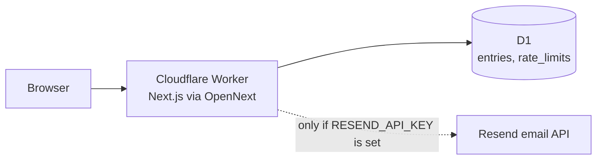

# Vero

**Proof-based hiring infrastructure, built by [VROE Labs](https://github.com/DevPatel128/vero).** Workers build a portable, dual-signed record of real work completed; businesses hire from that record instead of a resume.

## Status

**Pre-launch.** Only the marketing site and waitlist are live. The core product (identity verification, job posting, escrow, dual-signature records) is specified in [`PRODUCT.md`](PRODUCT.md) but not built. An earlier, never-deployed prototype and the older documentation layouts remain in git history only. Launch date: not set.

## What it does

### Shipped (in `website/site/`)
- A marketing site of about 50 static pages (product, audiences, pricing, roadmap, investors, trust, and legal pages under `/legal/`).
- Waitlist signup (`POST /api/waitlist/join`): email, role (worker or business), optional details, required consent. Each entry gets a queue position, a referral code and a private page at `/waitlist/[token]`. Each referral moves the referrer up 5 places.
- Public signup counts (`GET /api/waitlist/stats`) and a health check (`GET /api/health`).
- Investor materials request form (`POST /api/investors/request`), delivered by email only.
- Same-origin checks, a honeypot field and per-IP rate limits on every public form.
- Confirmation emails through Resend, when an API key is configured (not configured in production as of 2026-09-29).

### Planned (not built)
- Worker and business accounts with identity verification.
- Job posting without bidding, escrow payments (5% fee) and dual-signed work records owned by the worker.
- See [`PRODUCT.md`](PRODUCT.md) for phases and acceptance criteria.

## Stack

What the running site uses, from `website/site/package.json` and `wrangler.jsonc`:

| Layer | Choice |
|---|---|
| Framework | Next.js 16 (App Router), React 19, TypeScript 5 |
| Styling and motion | Tailwind CSS 3, `motion` (Framer Motion) |
| Fonts | Geist, Geist Mono, Spectral via `next/font` (self-hosted at build) |
| Validation | zod |
| Hosting | Cloudflare Workers through `@opennextjs/cloudflare` |
| Database | Cloudflare D1 (binding `DB`); local JSON file store in plain `next dev` |
| Email | Resend HTTP API (optional) |
| Tests | Playwright (API and browser end-to-end) |
| Runtime | Node 24 (`.nvmrc`) |

No analytics, no error tracking, no user accounts and no AI features run in production.

## Architecture



Details, data model, endpoints and threat model: [`SYSTEM.md`](SYSTEM.md).

## Structure

| Path | What it is | Status |
|---|---|---|
| [`website/site/`](website/site/) | The public website and waitlist app | Live |
| [`website/site/src/app/`](website/site/src/app/) | Pages and API routes (App Router) | Live |
| [`website/site/src/lib/`](website/site/src/lib/) | Waitlist store, rate limiting, email, same-origin check | Live |
| [`website/site/migrations/`](website/site/migrations/) | D1 schema migrations | Live |
| [`website/site/tests/`](website/site/tests/) | Playwright tests | Maintained |
| [`website/products/`](website/products/), [`website/shared/`](website/shared/) | Copy contracts and draft page copy for the site | Reference |
| [`sell/`](sell/) | Investor, user and interview material and deck outlines | Reference |
| [`AGENTS.md`](AGENTS.md) | Rules for anyone (human or AI agent) changing this repo | Maintained |
| [`PRODUCT.md`](PRODUCT.md), [`SYSTEM.md`](SYSTEM.md), [`RUNBOOK.md`](RUNBOOK.md), [`GROWTH.md`](GROWTH.md), [`LEGAL.md`](LEGAL.md) | What Vero is, how the site works, how to operate it, how it will grow, legal inventory | Maintained |
| [`DECISIONS.md`](DECISIONS.md), [`MISTAKES.md`](MISTAKES.md) | Decision and mistake ledgers | Maintained |
| [`scripts/`](scripts/) | WOLF framework checks (secret scan, repo and legal checks, PR gate) | Maintained |

The documentation follows the WOLF kit (one file per concept). Start with [`AGENTS.md`](AGENTS.md), then [`PRODUCT.md`](PRODUCT.md).

## Setup

Requires Node 24.

```sh
cd website/site
npm ci
cp .env.example .env.local   # all values are optional in development
npm run dev                  # http://localhost:3000
```

Plain `npm run dev` stores waitlist entries in a local, gitignored `data/waitlist.json`. To run against a local D1 instead: `npx wrangler d1 migrations apply vero-waitlist --local`, then start with `CF_DEV_BINDINGS=1`.

## Environment

See [`website/site/.env.example`](website/site/.env.example). Names only:

| Name | Where | Purpose |
|---|---|---|
| `NEXT_PUBLIC_SITE_URL` | build | Canonical URL, Open Graph, sitemap |
| `RESEND_API_KEY` | Worker secret | Sends email; unset means no email is sent |
| `WAITLIST_FROM_EMAIL` | Worker variable | Sender address on the domain verified in Resend. Replies go to vroelabs@gmail.com via Reply-To |
| `INVESTOR_INBOX` | Worker variable | Where investor requests go |
| `CF_DEV_BINDINGS` | local only | `1` uses local Cloudflare bindings in `next dev` |

Server-only secrets are never exposed to the browser. Never commit a real `.env` file.

## Develop and test

All from `website/site/`:

| Command | Purpose |
|---|---|
| `npm run typecheck` | TypeScript check |
| `npm run lint` | ESLint |
| `npm test` | Playwright API and end-to-end tests (starts `next dev` on port 3000, or reuses a server already there) |
| `npm run build` | Production Next.js build |
| `npm run cf-build` | Cloudflare Workers bundle (OpenNext) |
| `npm run preview` | Workers bundle served locally |

CI (`.github/workflows/ci.yml`) runs typecheck, lint, Playwright, both builds, `npm audit` (non-blocking) and gitleaks on pull requests that touch `website/site/`. `.github/workflows/wolf.yml` runs the WOLF PR gate on every pull request.

## Deploy

Manual: `npm run deploy` from `website/site/` (OpenNext build, then `wrangler deploy` to the Worker `vero`). Auto-deploy on push is not connected. Rollback and verification steps are in [`RUNBOOK.md`](RUNBOOK.md).

## Security

Please report vulnerabilities privately; see [`SECURITY.md`](SECURITY.md). The site sends security headers from `next.config.ts` (HSTS, frame denial, nosniff, referrer and permissions policies, and a report-only CSP). gitleaks scans every commit in CI.

## Limitations and roadmap

- Only the waitlist exists; no accounts, verification, escrow or records yet.
- No self-serve unsubscribe or data deletion; requests are handled by email.
- Rate limits fail open by design if D1 errors.
- The Content Security Policy is report-only, not enforced.
- No uptime monitoring or alerting.
- Vroe Labs is not yet a registered company; no postal address is published (see [`LEGAL.md`](LEGAL.md)).
- Roadmap: phases in [`PRODUCT.md`](PRODUCT.md), starting with a Bengaluru pilot.

## Contributing

See [`CONTRIBUTING.md`](CONTRIBUTING.md).

## License

Source-available under the Vroe Labs licence (PolyForm Strict 1.0.0): noncommercial use only; no changes, derivative works or redistribution. See [LICENSE](LICENSE).
