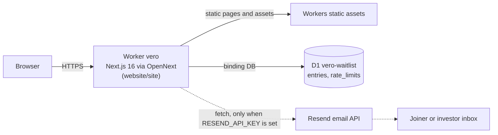
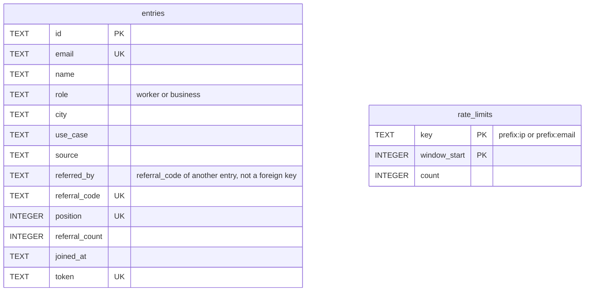
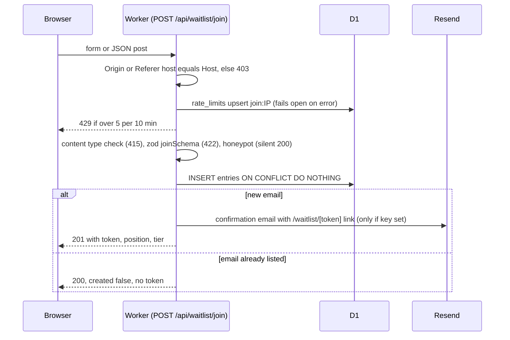

# SYSTEM.md

## Shape (live: marketing site and waitlist only)

Not shown because none exists: auth provider, analytics, error tracking, queues, cron, AI services.
- Code root: `website/site/`. Do not move or rename it; the Cloudflare build uses that path.
- Store selection (`src/lib/waitlist/index.ts`): D1 (`d1-store.ts`) when the binding exists; otherwise a local JSON file `data/waitlist.json` (`file-store.ts`, gitignored, dev and tests only). In production a missing D1 binding throws.
- Security headers are defined once in `next.config.ts`: X-Frame-Options DENY, nosniff, strict-origin-when-cross-origin, Permissions-Policy, HSTS, and a report-only CSP (enforcement deferred, no report URI).
- No error tracking and no product analytics (Sentry and PostHog were removed 2026-09-22; `/legal/cookies` says no third-party analytics).
- No user accounts, no auth, no AI feature in production.
- Planned product app (not built): a prototype used Supabase auth, Argon2id (`@node-rs/argon2`) and JOSE tokens, Razorpay escrow, MSG91 OTP and DigiLocker. It was never reviewed or deployed and now sits only in the archive. The `@rie/crypto` versus direct-libraries question is open (see `DECISIONS.md`); resolve it before any auth code ships.

## Data model
Waitlist data has no `user_id`: it is not user-account data, so the kit's `forUser()` rule does not apply yet. It applies from the first user table.
| Table | Columns | Class | Writable by client |
|---|---|---|---|
| `entries` | id PK, email UNIQUE, name, role (`worker`/`business`), city, use_case, source, referred_by, referral_code UNIQUE, position UNIQUE, referral_count, joined_at, token UNIQUE (144-bit secret for `/waitlist/[token]`) | personal | email, name, role, city, use_case, source, referred_by through the join schema only. Insert uses `ON CONFLICT DO NOTHING`. |
| `rate_limits` | key, window_start (PK pair), count | internal | no |

Migrations: `website/site/migrations/` (`0001_init.sql`). Planned product schema (20 tables in the archived prototype migration, including `user_consents`, `audit_logs` with 7-year retention, `refresh_tokens`): not deployed.

## Env vars and secrets (names only)
| Name | Where | Purpose |
|---|---|---|
| `NEXT_PUBLIC_SITE_URL` | build variable (inlined at build) | canonical URL, OG, sitemap; code default `https://vero.work` |
| `RESEND_API_KEY` | Worker secret | sends email; when unset, emails are logged without recipient or token. Not set in production as of 2026-09-29. |
| `WAITLIST_FROM_EMAIL` | Worker variable | sender address |
| `INVESTOR_INBOX` | Worker variable | investor request inbox; falls back to `site.contact.investors` |
| `CF_DEV_BINDINGS` | local only | `1` uses a local D1 in dev after `npx wrangler d1 migrations apply vero-waitlist --local` |

## Endpoints
| Method path | Auth | Authz rule | Input schema | Limits | Idempotent | Errors |
|---|---|---|---|---|---|---|
| `POST /api/waitlist/join` | none | Origin or Referer host must equal Host | zod `joinSchema` (JSON, urlencoded or multipart): email ≤255, role enum, name ≤120, city ≤120, useCase ≤500, source ≤120, referredBy ≤64, honeypot `website` empty, consent true | 5 per IP per 10 min | yes, by email; duplicate returns no token | 403 `invalid_origin`, 415, 422 `invalid_input`, 429 `rate_limited`, 500 `server_error` |
| `GET /api/waitlist/stats` | none | public counts | none | cached 60 s | yes | 503 `store_unavailable` |
| `POST /api/investors/request` | none | same-origin check | zod: name, email, firm, NDA true, optional role, stage, thesis ≤1500, honeypot `company` | 3 per IP per hour, 2 per email per 24 h | no | 403, 422, 429, 500 |
| `GET /api/health` | none | public | none | no-store | yes | 503 `{ok:false}` |
Also served: `/robots.txt`, `/sitemap.xml`, `/llms.txt`, `/manifest.webmanifest`, `/.well-known/security.txt`.

## Waitlist join flow

## Authorization matrix
| Action | anon | user (own) | admin |
|---|---|---|---|
| Join waitlist, request investor materials, read stats and health | yes (same-origin, rate limited) | n/a | n/a |
| Read own waitlist page | holder of the token only | n/a | n/a |
| Read or change other entries | no route exists | n/a | Cloudflare dashboard only |

## Threat model (lite)
| Asset | Actor | Attack path | Mitigation | Residual risk |
|---|---|---|---|---|
| Waitlist token and email | web client | duplicate join to read someone's token | duplicate join returns no token (fixed `c6e7624`) | timing difference between create and duplicate paths, judged low |
| Public POST routes | scripts | spam, resource abuse | D1 fixed-window rate limits | fail open by design; `clientIp()` uses `cf-connecting-ip` and only falls back to the first `x-forwarded-for` entry (client-spoofable) when that header is absent, which on Workers should not happen (UNVERIFIED) |
| Signup counts | concurrent requests | race on position or referral count | UNIQUE constraints and `ON CONFLICT DO NOTHING` | none identified |
| Cross-site forms | third-party site | forged POST | Origin equals Host check (`src/lib/same-origin.ts`) | none for a store without session cookies |
| Investor inbox target | abuser | mail-bomb an address via many IPs | per-email limit | none identified |
| Email in URLs and logs | logs, referrers | PII leakage | email handoff moved out of the query string; `email.ts` never logs recipient, token or provider body | none identified |
Repo is public. Secret scanning, push protection, private vulnerability reporting and Dependabot security updates were verified on 2026-09-29. gitleaks runs in CI.

## Limits and cost
| Resource | Free limit | Current use | Headroom |
|---|---|---|---|
| Cloudflare plan for Workers and D1 | UNKNOWN (plan tier not recorded) | pre-launch, no paid usage | UNKNOWN |
| D1 Time Travel retention | UNKNOWN (not confirmed) | | |
| Resend | UNKNOWN | not configured in production | |
